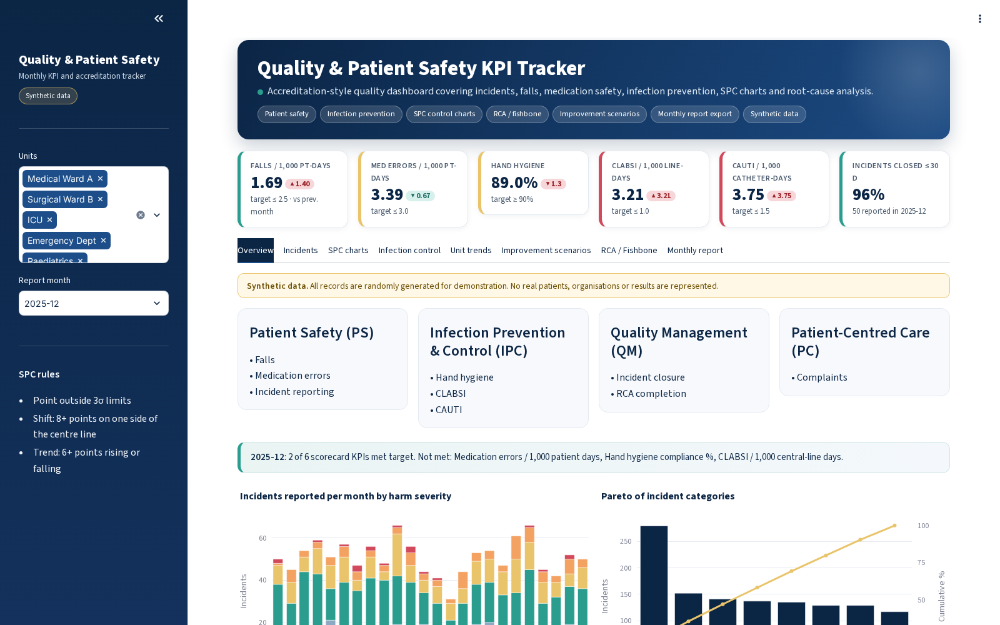
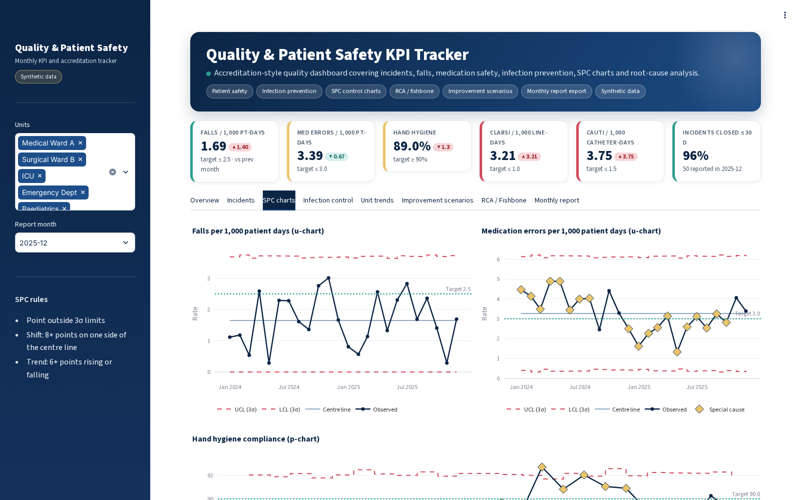
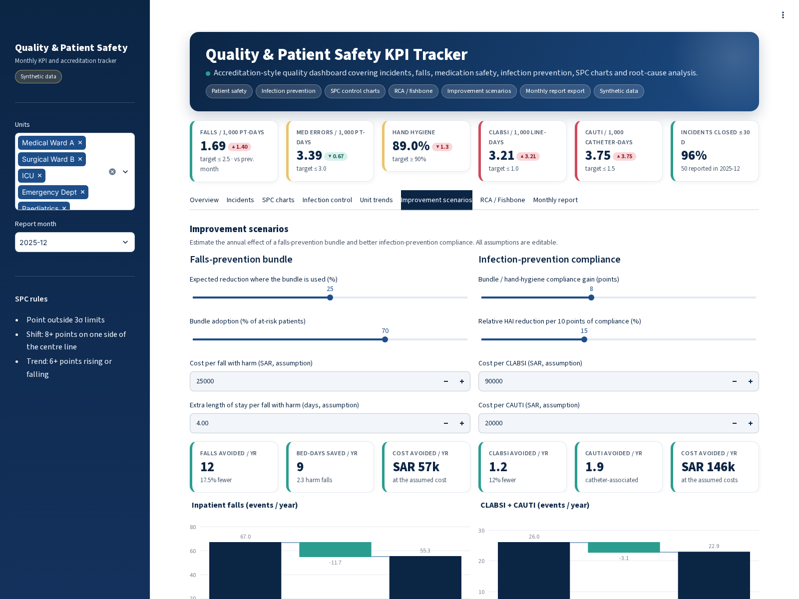
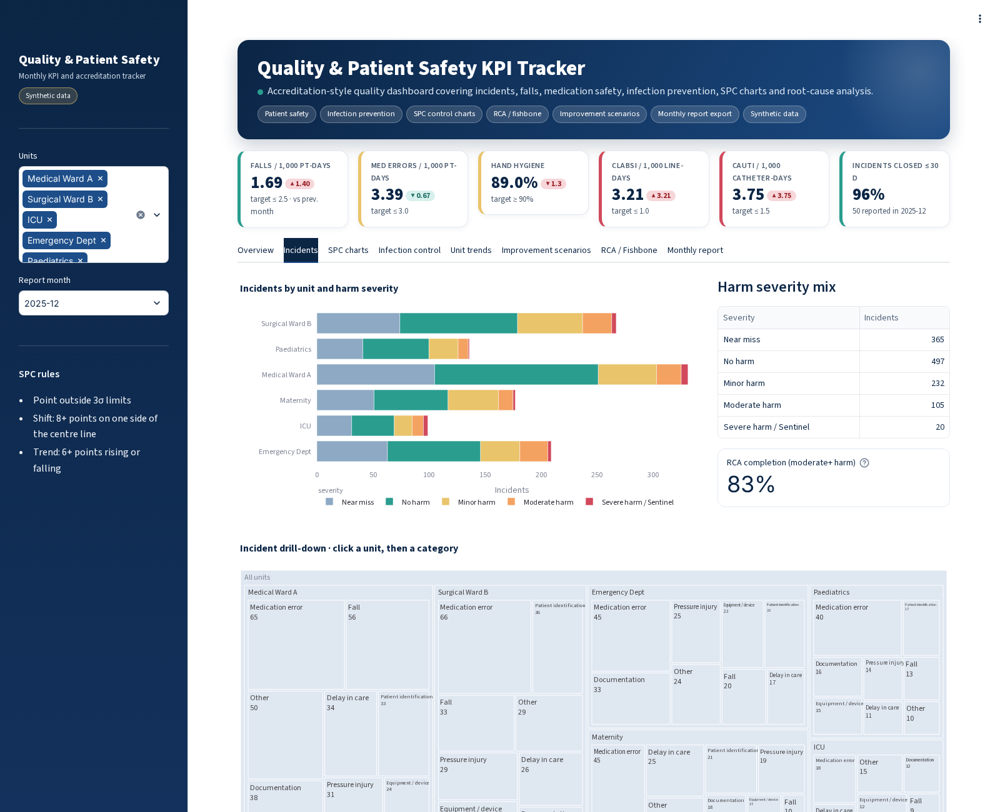
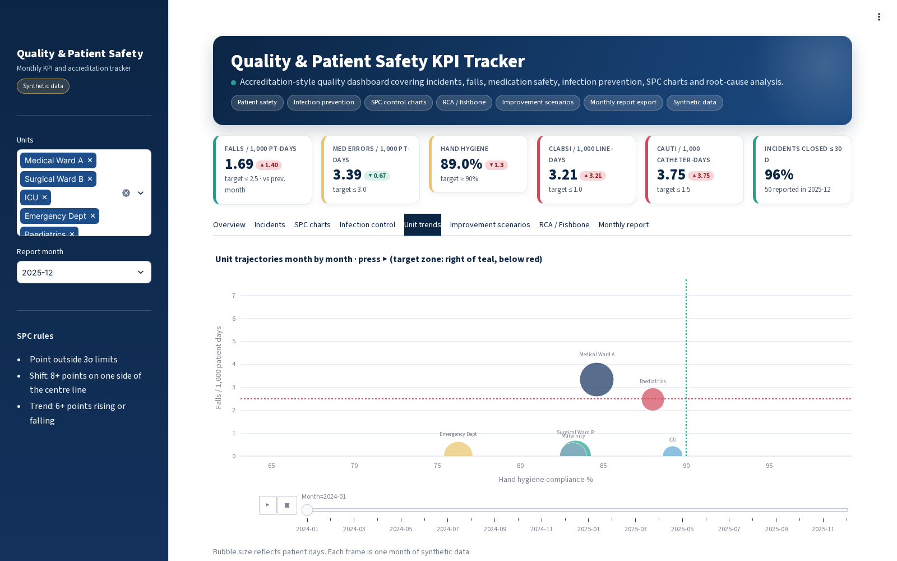
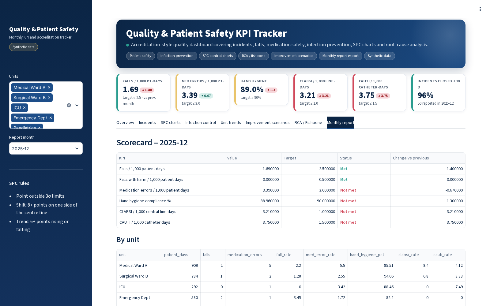
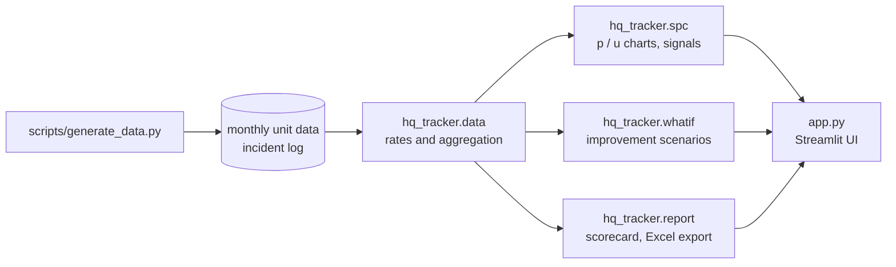

<div align="center">

# Healthcare Quality & Patient Safety KPI Tracker

**Monthly quality and patient-safety dashboard with SPC control charts, incident drill-down, RCA tooling and improvement scenarios.**

    [](https://github.com/MOHAMMEDYOUSEFALAHMADI/healthcare-quality-kpi-tracker/actions/workflows/tests.yml)  

</div>

> **Synthetic data only.** Every record in this repository is generated by a script with a fixed random seed.
> No real patients, staff, organisations or payers are represented, and the figures are not real-world results.

## Why this project

Quality departments spend a lot of time each month pulling the same indicators together for committees
and accreditation surveys: falls, medication errors, hand hygiene, device-associated infections, incident
closure and RCA completion. The numbers often end up in spreadsheets with no way to tell normal variation
from a real change.

This tracker brings those indicators into one place, uses statistical process control so that a bad month is
only flagged when it is a genuine signal, and adds the tools a quality team uses after the signal: an
incident drill-down, a fishbone and action plan for RCA, a scenario estimate for a proposed improvement
bundle, and a monthly report that can be exported straight to Excel.

## Features

- **Monthly scorecard** against targets for falls, medication errors, hand hygiene, CLABSI, CAUTI and incident closure, with change vs the previous month
- **SPC control charts**: u-charts for event rates and a p-chart for hand hygiene, with automatic special-cause detection (point outside 3σ, shift of 8+ points, trend of 6+ points)
- **Incident drill-down**: click through a treemap from unit to category to harm severity; severity mix, Pareto of categories and the incident log
- **Infection prevention**: CLABSI and CAUTI control charts and a unit comparison heatmap
- **Animated unit trends**: each unit's hand hygiene vs fall rate, month by month
- **Improvement scenarios**: estimated falls, bed-days and cost avoided by a falls-prevention bundle, and HAIs avoided by better bundle compliance, using editable assumptions
- **RCA / fishbone** builder with an editable action plan and Markdown export
- **Monthly report** export to Excel and Markdown
- Domains organised in an accreditation-style structure (patient safety, infection prevention, quality management, patient-centred care)

## Screenshots

**Overview: monthly KPIs with change vs previous month, severity mix and incident Pareto**



**SPC control charts with special-cause signals**



**Improvement scenarios for falls prevention and infection prevention**



**Incident drill-down treemap and incident log**



**Animated unit trajectories**



**Monthly scorecard and export**



## KPIs and methods

| Indicator | Definition | Target |
|---|---|---|
| Fall rate | falls ÷ patient days × 1,000 | ≤ 2.5 |
| Medication error rate | reported medication errors ÷ patient days × 1,000 | ≤ 3.0 |
| Hand hygiene | compliant observations ÷ observations | ≥ 90% |
| CLABSI | CLABSI ÷ central-line days × 1,000 | ≤ 1.0 |
| CAUTI | CAUTI ÷ urinary-catheter days × 1,000 | ≤ 1.5 |
| Incident closure | incidents closed within 30 days | ≥ 85% |

**SPC.** Rates use u-charts (limits = ū ± 3√(ū / exposure)); proportions use p-charts
(p̄ ± 3√(p̄(1 − p̄) / n)). Limits vary month to month with the denominator.

**Scenarios.** Falls avoided = annual falls × expected effect × adoption. HAIs avoided assume a linear
relative reduction per 10 points of compliance gain, capped at 80%. All effect sizes and costs are inputs
to be replaced with local evidence.

## Architecture



```text
healthcare-quality-kpi-tracker/
├── app.py                    # Streamlit app
├── hq_tracker/
│   ├── charts.py             # Plotly figures
│   ├── config.py             # units, domains, KPI targets
│   ├── data.py               # synthetic generator, rates, aggregation
│   ├── rca.py                # fishbone and action-plan helpers
│   ├── report.py             # scorecard and Excel / Markdown export
│   ├── spc.py                # p-chart, u-chart and special-cause rules
│   ├── ui.py                 # theme, KPI cards and layout helpers
│   └── whatif.py             # improvement scenario estimates
├── scripts/                  # data generation
├── data/                     # synthetic CSV files
├── tests/                    # pytest suite
├── docs/screenshots/
├── .streamlit/config.toml    # theme
├── .github/workflows/        # CI: pytest on every push
└── requirements.txt
```

## Getting started

```bash
git clone https://github.com/MOHAMMEDYOUSEFALAHMADI/healthcare-quality-kpi-tracker.git
cd healthcare-quality-kpi-tracker
python -m venv .venv
source .venv/bin/activate        # Windows: .venv\Scripts\activate
pip install -r requirements.txt

streamlit run app.py             # http://localhost:8501
```

To regenerate the synthetic data:

```bash
python scripts/generate_data.py --months 24 --seed 7
```

## Tests

```bash
pytest
```

The suite checks the data generator, every KPI calculation, the scenario logic and that each chart builds.

## Tech stack

Python · Streamlit · pandas · NumPy · Plotly · openpyxl · pytest

## Data statement

The data is produced by `scripts/generate_data.py` from random distributions with fixed seeds, so every run
is reproducible. Names of units, stations, payers, projects and objectives are generic placeholders. The app
has not been deployed in any organisation, and nothing here should be read as a measured outcome.

## Roadmap

- [ ] Funnel plots for comparing units of different size
- [ ] Patient experience and complaints module
- [ ] Upload of a real monthly extract with column mapping and validation
- [ ] Arabic / English interface

## Author

**Mohammed Alahmadi** · healthcare operations, quality, EMS and PMO
[LinkedIn](https://www.linkedin.com/in/mohyou) · [GitHub](https://github.com/MOHAMMEDYOUSEFALAHMADI)

## License

[MIT](LICENSE)
